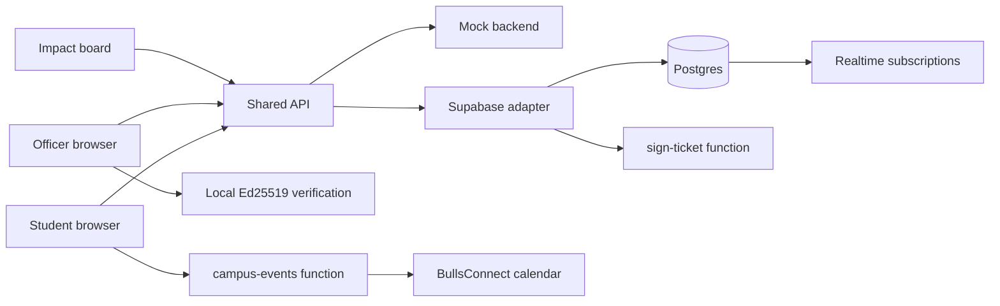

# lastcall

lastcall connects leftover food from campus events with students. Officers
post available portions, students join a short draw or claim remaining portions,
and officers verify signed tickets at pickup.

## Run locally

Use the Node version required by the installed Vite package, then:

```bash
npm install
npm run dev
```

The default URL is `http://localhost:5173`. This repository is configured for a
live Supabase project through a private `.env.local`; do not print or commit that
file. For an isolated demo using local data, override the backend flag:

```bash
VITE_USE_MOCK=1 npm run dev
```

Mock data syncs between tabs on the same origin through localStorage and
BroadcastChannel. It does not sync between phones or separate browser profiles.
Tabs share one device identity. When storage is unavailable, mock data remains
in memory for the current session only.

## Configuration

| Variable | Purpose |
|---|---|
| `VITE_USE_MOCK` | `1` selects the local mock backend |
| `VITE_SUPABASE_URL` | Supabase project URL |
| `VITE_SUPABASE_ANON_KEY` | Supabase publishable/anonymous client key |
| `VITE_TICKET_PUBLIC_KEY` | Base64url Ed25519 public key for local QR verification |
| `VITE_DEMO` | `1` shortens the lottery to 20 seconds |

Adding `?demo=1` also shortens the lottery. Demo timing does **not** select the
mock backend: a demo URL can still create real records on Supabase.

The ticket private key belongs only in the signing function's server-side secret.
Database passwords must never use a `VITE_` variable name.

## Architecture



`src/shared/api.ts` defines the interface used by the mock and Supabase adapters.
The feed is loaded initially; secondary routes are loaded on demand. A failed
page download offers a reload action instead of leaving a blank screen.

Public database columns expose hashes instead of raw device IDs. Ticket secrets
are kept separately from public claims. Device IDs provide prototype identity;
this is not a replacement for real authentication. The current backend still
needs an authorization review before a public campus rollout.

## Fair-share allocation

- During the 45-second window (20 seconds in demo mode), claims remain pending.
- At resolution, each entrant has weight `1 / (1 + wins_in_the_last_7_days)`.
  A private priority setting doubles this weight. Doubling weight does not mean
  exactly doubling a student's probability of winning.
- The server selects winners without replacement, up to the available portions.
- Remaining portions can be claimed after the draw through an atomic decrement.
- Each device can claim at most once per post.

Priority choices are not displayed to other students, officers, or the board.
The board does show first names for recent pickups.

## Tickets and offline pickup

Tickets contain `LB1.<base64url(payload)>.<base64url(signature)>`. The payload is:

```json
{"c":"claim_id","p":"post_id","k":"K7P2QX","e":1234567890}
```

The signer uses Ed25519. Officers verify the signature and expiry locally, check
that the post matches, and check current pickup status when connected. Manual
codes use `findClaimByCode()` and require a connection.

The student screen saves ticket data and pickup location locally. This supports
an already loaded page; there is no service worker guaranteeing an offline
reload of the application shell or a first visit to a lazy-loaded route.

An offline QR pickup is queued on the officer device. Reconnecting retries the
queue. Duplicate scans on that device are rejected. A pickup recorded on another
offline device cannot be detected until the devices reconnect.

If the server rejects a queued pickup, its name, code, and reason remain visible
for review. Expired entries are not silently discarded or automatically counted
as rescued meals. Accepting pickups synced after expiry needs an explicit
server-side reconciliation policy; a browser timestamp alone is not trusted
proof of when the food was handed over.

## Campus events

`/events` displays upcoming BullsConnect entries matched by food tags or food
words. The `campus-events` function parses the calendar and returns a 14-day
window. These are event listings, not reserved portions or guaranteed meals.

## Routes

| Route | Purpose |
|---|---|
| `/` | Student feed and claims |
| `/events` | Upcoming campus events with food mentions |
| `/ticket/:claimId` | Saved ticket, QR, code, and pickup state |
| `/me` | Display name, diet preferences, private priority |
| `/post` | Officer post form |
| `/officer/:postId` | Claims, QR/manual verification, offline queue |
| `/board` | Campus impact display and pickup ticker |
| `/about` | Problem, process, and fairness explanation |

## Validation

```bash
npx tsc -b
npm test
npm run build
```

Tests force the mock backend through `vite.config.ts`. They cover ticket
signatures, weighting, the mock post-to-pickup lifecycle, storage failure,
expiry, offline queue retries, and student ticket caching. They do not prove
that the deployed database or a phone camera works.

The database test scripts require a disposable local database with the migrations
applied. They create test rows; do not point them at the production seed database.

## Release checks

See `RELEASE_CHECKLIST.md` for the checks that require a working browser and real
phones. The production URL is `https://leftover-bulls.vercel.app`.

Deploy with the already-linked Vercel CLI when authorized:

```bash
vercel deploy --prod --yes
```

A successful build alone does not confirm deployment. Check that Vercel reports
Ready and that the production alias serves the new version. Local notes,
documentation, credentials, and tooling files are excluded by `.vercelignore`.
